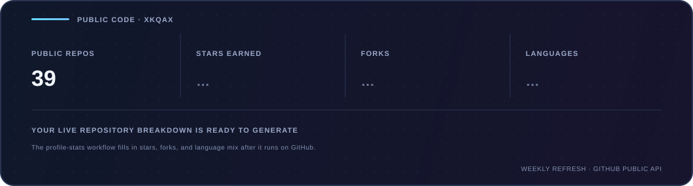

  

<h1 align="center">Hey, I'm Santiago Cacua 👋</h1>

  <strong>SOFTWARE ENGINEER · COLOMBIA 🇨🇴</strong>

  I build thoughtful digital experiences for the web and explore how software can connect with data, science, and the real world.

  <a href="https://xkqax.github.io/Portafolio/">Portfolio</a> &nbsp;·&nbsp;
  <a href="https://github.com/xKQAx?tab=repositories">Explore my repositories</a>

  <a href="#about">About</a> ·
  <a href="#what-im-exploring">What I'm exploring</a> ·
  <a href="#selected-work">Selected work</a> ·
  <a href="#toolkit">Toolkit</a>

<h2 align="center">A little GitHub snapshot</h2>

  

Generated from public repository data · refreshed weekly

---

### About

I'm a software engineer who enjoys taking an idea from concept to a useful, polished experience. My interests span web and mobile development, data science, computational biology, and interactive projects.

### What I'm exploring

| 🌐 Web & mobile | 🧬 Science & data | ✨ Interactive experiences |
| --- | --- | --- |
| Building accessible, useful applications and learning new ways to bring ideas to life. | Exploring computational biology and the ways software can support research. | Creating playful experiences that bring digital projects into the real world. |

### Selected work

| Project | A little about it |
| --- | --- |
| 🌱 [Portfolio](https://github.com/xKQAx/Portafolio) | My personal website, built with React, TypeScript, and Vite. |
| 🪄 [Digital Fest](https://github.com/xKQAx/digital-fest) | A WebAR experience for exploring 3D figures in the browser. |
| 🧬 [Computational Biology](https://github.com/xKQAx/biologiacomputacional) | A Django platform for services, research, and contact. |
| 🎯 [Trivia Colombia](https://github.com/xKQAx/trivia-colombia) | An educational quiz game about Colombia. |

### Toolkit

  
  
  
  
  
  
  
  

  <i>Curious by nature. Building one idea at a time.</i>

